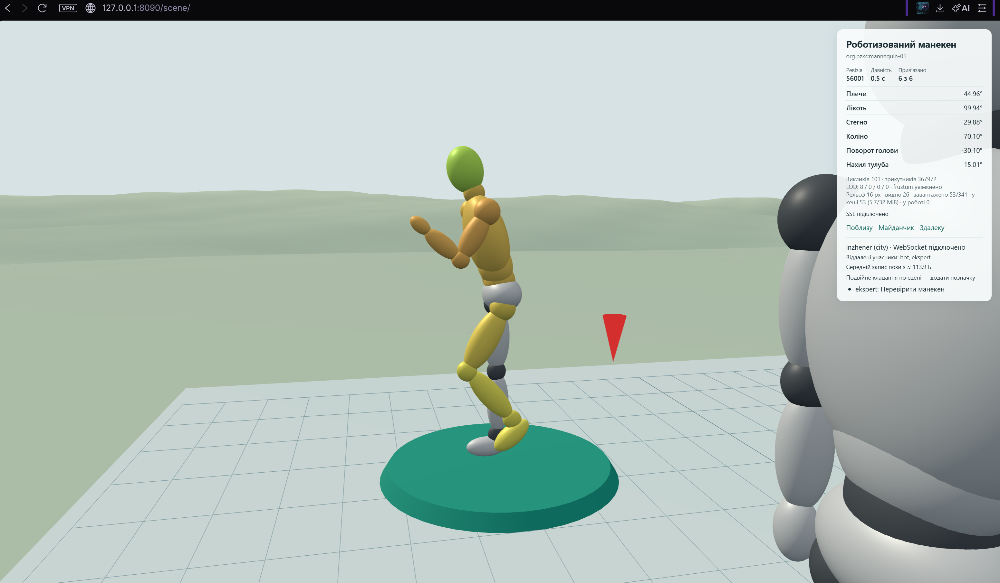
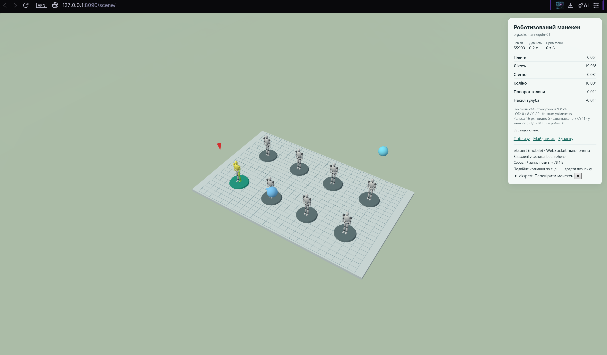

# Розподілене багатокористувацьке середовище

## Спільний стан

| Складник | Як змінюється | Чи можна пропустити оновлення | Джерело істини |
|---|---|---|---|
| Поза аватара учасника (`p`, `q`) | Клієнт надсилає позицію та орієнтацію. Сервер перевіряє координати й зберігає останню коректну позу | Так. Для наступного знімка достатньо найсвіжішої пози учасника | Клієнт, якому належить аватар |
| Присутність учасника в сеансі | Сервер реєструє підключення, а після від’єднання прибирає позу учасника зі знімків | Так. Кожний наступний знімок містить актуальний набір віддалених аватарів | Сервер сеансу |
| Позначки на майданчику | Сервер перевіряє текст і координати, присвоює ідентифікатор і надсилає повний список. Видалити позначку може підключення, яке її створило | Проміжний список можна пропустити, якщо отримано пізніший повний список | Сервер сеансу |
| Телеметрія манекена `org.pzks:mannequin-01` | Клієнт отримує початковий стан через HTTP і подальші оновлення через SSE | Для відображення поточного стану достатньо останнього актуального значення | Eclipse Ditto |

Сервер сеансу працює через WebSocket на порту 8091 і формує знімки кожні 50 мс (20 Гц). Знімок містить мітку часу сервера та останні відомі пози інших учасників. Телеметрія манекена надходить до кожного клієнта окремо від Ditto.

Мережевий профіль задається параметром підключення. У кожному напрямку окремо моделюється затримка RTT/2 з додатковим джитером. З імовірністю, заданою профілем, повідомлення затримується ще на один RTT, що імітує повторне передавання TCP. Порядок доставки в межах одного напрямку зберігається.

## Сценарій

Інженер оглядає рухомий манекен `mannequin-01` і позначає на майданчику місце, яке потрібно перевірити. Експерт відкриває сцену в іншому вікні, бачить ту саму позначку й спостерігає, куди дивиться інженер. Поза кожного аватара відповідає положенню й орієнтації камери відповідного учасника. Бот рухається навколо майданчика по колу радіусом 6 м і зупиняється на 2 с кожного 10-секундного циклу.

Подвійне клацання по геометрії сцени створює позначку з текстом. Сервер присвоює їй ідентифікатор і надсилає повний список обом учасникам. Кнопка видалення доступна у вікні автора позначки. Застосунок надсилає позу камери кожні 50 мс, а бот надсилає свою позу кожні 49 мс.

Під час перевірки до сеансу підключено трьох учасників: інженера (`city`), експерта (`mobile`) і бота (`lan`). Позначка, створена експертом, з’явилася в обох вікнах. Кнопка видалення відображалася лише у вікні експерта.

За сім стабільних п’ятисекундних інтервалів вихідний потік сервера становив 117,8–122,2 кбіт/с, у середньому 119,9 кбіт/с. За формулою \(R_c = 8 \cdot N \cdot K \cdot f \cdot s\), де \(N=3\), \(K=2\), \(f=20\) Гц, а \(s \approx (78{,}4 + 113{,}9)/2 = 96{,}15\) байта за показами двох клієнтів, розрахункова оцінка становить 92,3 кбіт/с. Оцінка є наближеною: розмір запису залежить від учасника, а серверний лічильник також враховує службові поля знімків і повідомлення про позначки.

*Рис. 1. Вікно інженера. Червона позначка експерта відображається у сцені та списку.*

*Рис. 2. Вікно експерта. Кнопка × доступна автору позначки.*

## Профілі мережі

Виконано чотири 60-секундні прогони з одним спостерігачем і ботом. Бот надсилав позу через профіль LAN кожні 49 мс, а сервер формував знімки кожні 50 мс.

За формулою (5) затримка інтерполяції дорівнює `D_int = (m + 1) × T_sn + J`, де `T_sn = 50 мс`, `m` — кількість пропусків, на яку розраховано буфер, а `J` — параметр джитера профілю. Це дає 51 мс для LAN, 105 мс для City і 130 мс для Mobile. В екстраполяції `D_int = 0`.

За формулою (6) `L_AB = L_up + t_wait + L_down + D_int`. Для бота `L_up = 1 мс`, середнє очікування знімка `t_wait = T_sn / 2 = 25 мс`, а `L_down` дорівнює половині модельного RTT спостерігача.

| Профіль і режим | RTT модель / p50, мс | D_int, мс | L_AB за (6), мс | Затримка показу p50 / p95, мс | p50 − розрахунок, мс | Без новішого знімка, % | Макс. відхилення, см |
|---|---:|---:|---:|---:|---:|---:|---:|
| [LAN, інтерполяція](../results/net-lan-interp.json) | 2 / 31 | 51 | 78 | 110 / 136 | +32 | 37,7 | 0,17 |
| [City, інтерполяція](../results/net-city-interp.json) | 20 / 33 | 105 | 141 | 166 / 182 | +25 | 0 | 0,16 |
| [Mobile, інтерполяція](../results/net-mobile-interp.json) | 60 / 110 | 130 | 186 | 208 / 228 | +22 | 0,3 | 0,17 |
| [Mobile, екстраполяція](../results/net-mobile-extrap.json) | 60 / 116 | 0 | 56 | 74 / 146 | +18 | 100 | 12,12 |

З інтерполяцією максимальне відхилення залишалось у межах 0,16–0,17 см. Тому прогони могли виглядати подібно, хоча медіана затримки зросла зі 110 мс у LAN до 208 мс у Mobile. У Mobile екстраполяція зменшила медіану з 208 до 74 мс і збільшила максимальне відхилення з 0,17 до 12,12 см. У 100 % кадрів екстраполяції не було знімка новішого за розрахунковий момент показу. Клієнт будував прогноз за останніми доступними позами.

Виміряні медіани перевищили номінальні оцінки на 18–32 мс. Джитер, повторне передавання та планування обробки в Node.js і браузері можуть збільшувати реальну затримку. У LAN налаштований джитер до 1 мс у кожному напрямку, а повторне передавання в моделі вимкнено. Медіанний RTT 31 мс за номіналу 2 мс вказує на додаткову затримку поза номінальною моделлю каналу. Її складники в цьому експерименті окремо не вимірювалися.

## Архітектурні обмеження

1. **Спільний огляд.** City та Mobile з інтерполяцією придатні для огляду майданчика й обміну позначками. Їхній p95 затримки показу становив 182 і 228 мс відповідно. У LAN буфер 51 мс залишив 37,7 % кадрів без новішого знімка. Збільшення резерву з `m=0` до `m=1` додало б 50 мс затримки й потребувало б окремої перевірки плавності.
2. **Екстраполяція.** Для швидшого віддаленого огляду Mobile можна застосувати прогноз пози тривалістю до 250 мс. У прогоні максимальна похибка досягла 12,12 см. Це обмежує використання режиму для задач, чутливих до точності положення.
3. **Порядок доставки.** WebSocket поверх TCP забезпечує впорядковану доставку поз і позначок. У профілі Mobile імітоване повторне передавання додає 60 мс і може затримати нові повідомлення в черзі. Для частих поз невпорядкований канал міг би відкидати старі оновлення. Для позначок доцільно зберегти надійний канал із серверним порядком подій.
4. **Пропускна здатність.** За розсилання кожному учаснику поз усіх інших потік зростає як `N(N−1)` при 20 Гц. За оцінкою 96,15 байта на запис дев’ять учасників потребували б близько 1,11 Мбіт/с лише для записів поз. За модельного бюджету 1 Мбіт/с такий сеанс потребує відбору видимих учасників або зниження частоти оновлень.
5. **Відмова сервера та команди.** Порт 8091 обслуговує спільні аватари й позначки, а телеметрія двійника надходить через вебсцену на порту 8090. Прототип зберігає позначки в пам’яті сервера, тому перезапуск сеансу їх скидає. Фізичне керування манекеном потребує окремого контуру з перевіркою прав, виключного доступу, актуальності команди й підтвердження виконання.

Архітектурне рішення зафіксовано в [ADR 0005](adr/0005-synkhronizatsiia-stseny.md).
