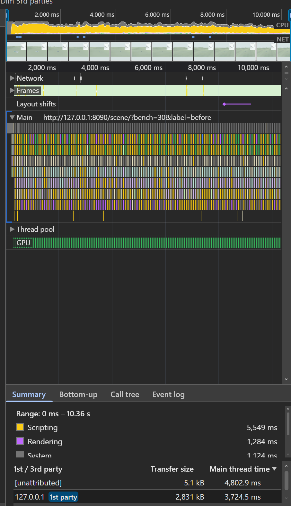
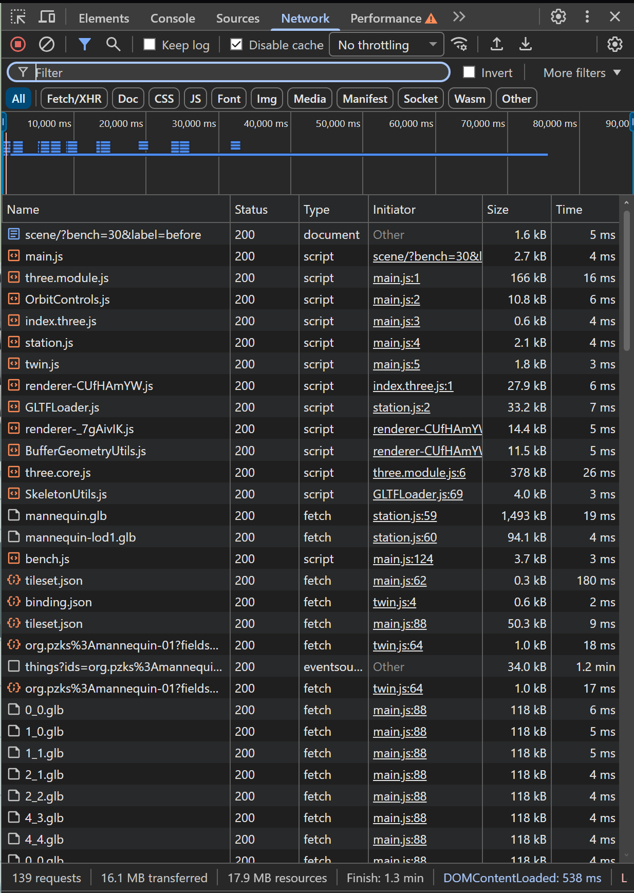

## Бюджет

Найслабший цільовий пристрій для вебподання роботизованого манекена — ноутбук оператора з інтегрованою графікою та дисплеєм 60 Гц. Роздільна здатність рендерингу під час профілювання — 1920 × 1080. Моделі ЦП і ГП випробувального комп’ютера — Intel(R) Core(TM) i7-14700HX та Intel(R) UHD Graphics (активний адаптер WebGL у базовому прогоні).

Слабший ЦП моделюється уповільненням у 6 разів у DevTools. Час роботи ГП вимірюється на фактичній відеокарті випробувального комп’ютера. Значення бюджету задано до профілювання.

| Показник | Ціль | Підстава | Спосіб вимірювання | Поле результату |
|---|---|---|---|---|
| Частка кадрів у бюджеті | ≥ 99 % кадрів із `max(T_CPU, T_GPU) ≤ 16,67 мс` | За частоти 60 Гц на кадр припадає `1000 / 60 ≈ 16,67 мс` | Час виконання кадру в JavaScript і час роботи ГП за таймером WebGL2 | `in_budget_pct` |
| Виклики рисування за кадр | ≤ 50 | Модельне припущення. За бюджету 16,67 мс, витрат на логіку 6 мс і вартості одного виклику 0,2 мс розрахункова межа становить близько 53 викликів. Ціль округлено до 50 із запасом | Максимум `renderer.info.render.calls` за прогін | `calls_max` |
| Трикутники за кадр | ≤ 300 000 | Модельна межа для інтегрованої графіки. Ураховує геометрію манекенів, майданчика й тайлів рельєфу в кадрі | Максимум `renderer.info.render.triangles` за прогін | `triangles_max` |
| Пам’ять текстур | ≤ 16 МБ | Модельний ліміт пам’яті, виділеної під текстури сцени | Оцінка за розмірами й форматами унікальних текстур | `textures_mb` |
| Дані до першого кадру | ≤ 1,9 МБ | Модель підключення зі швидкістю 5 Мбіт/с. За 3 с можна передати `5 × 3 / 8 = 1,875 МБ` | Сума `encodedBodySize` ресурсів, що завантажилися до позначки `first-frame` | `data_first_frame_mb` |

У таблиці 1 МБ = 1 000 000 байтів. Бюджет текстур і кеш геометрії рельєфу 32 MiB обліковуються окремо.

## Профілювання

Базовий прогін виконано в Opera GX за роздільної здатності рендерингу 1920 × 1080, з уповільненням ЦП у 6 разів і вимкненим кешем браузера. Після 3 с прогріву сцена вимірювалася протягом 30 с за заданою траєкторією камери. Зафіксовано 1779 кадрів із середньою частотою 59,3 кадр/с. Час роботи ГП отримано для всіх кадрів. Результат збережено в [`perf-before.json`](../results/perf-before.json).

| Показник | Ціль | Базовий результат | Оцінка |
|---|---:|---:|---|
| Частка кадрів у бюджеті 16,67 мс | ≥ 99 % | 98,99 % | Нижче цілі на 0,01 в. п. |
| Максимум викликів рисування | ≤ 50 | 264 | Перевищено |
| Максимум трикутників за кадр | ≤ 300 000 | 561 676 | Перевищено |
| Оцінка пам’яті текстур | ≤ 16 МБ | 0 МБ | У межах бюджету |
| Дані до першого кадру | ≤ 1,9 МБ | 2,24 МБ | Перевищено |

Медіана та 99-й процентиль часу ЦП становили 5,20 і 13,10 мс, а часу ГП — 6,35 і 15,74 мс. Медіана періоду між кадрами становила 16,70 мс, а 99-й процентиль — 33,30 мс. На трасі Performance видно активність головного потоку та ГП під час руху камери.

### Вузькі місця

| Показник | Причина або джерело навантаження | Оптимізація для перевірки |
|---|---|---|
| Виклики рисування | Сегменти манекенів рисуються окремими сітками. Майданчик і видимі тайли також додають виклики | Інстансування однакових сегментів статичних манекенів |
| Трикутники | Під час обльоту в кадр одночасно потрапляють детальні манекени та тайли рельєфу | Спрощення детального рівня моделі |
| Дані до першого кадру | Стартове завантаження включає обидві моделі манекена. У Network детальна модель `mannequin.glb` займає близько 1,49 МБ | Показ спрощеної моделі в першому кадрі та відкладене завантаження детальної |

## Оптимізації

- **Спрощення геометрії (`simp`).** Для детального рівня використано модель із 15 456 трикутниками замість 61 824. Збережено шість ідентифікаторів шарнірів. Підготовка потребує окремого експорту, а зблизька модель має менше геометричних деталей.
- **Інстансування (`inst`).** Однакові деталі семи статичних манекенів групуються за рівнем деталізації. Рухомий манекен зберігає окремі шарніри для телеметрії. Списки екземплярів оновлюються, коли манекени змінюють рівень деталізації або входять у поле зору.
- **Відкладене завантаження (`defer`).** Перший кадр показує спрощену модель. Детальна модель та рельєф завантажуються після нього, тому повна деталізація з’являється пізніше. В окремому прогоні обсяг даних до першого кадру знизився з 2,24 до 0,75 МБ, а загальний обсяг залишився 16,06 МБ.

## До і після

| Показник | Бюджет | До | `simp` | `inst` | `defer` | Після |
|---|---:|---:|---:|---:|---:|---:|
| Кадрів у бюджеті, % | ≥ 99 | 98,99 | 98,93 | 99,77 | 98,92 | 100 |
| Час ЦП, медіана / p99, мс | — | 5,20 / 13,10 | 5,70 / 13,70 | 4,90 / 11,20 | 5,50 / 14,10 | 4,10 / 8,80 |
| Час ГП, медіана / p99, мс | — | 6,35 / 15,74 | 6,41 / 14,76 | 5,97 / 8,25 | 6,30 / 14,84 | 6,03 / 7,24 |
| Виклики рисування, максимум | ≤ 50 | 264 | 264 | 109 | 264 | 110 |
| Трикутники за кадр, максимум | ≤ 300 000 | 561 676 | 297 148 | 561 676 | 561 676 | 297 148 |
| Пам’ять текстур, МБ | ≤ 16 | 0 | 0 | 0 | 0 | 0 |
| Дані до першого кадру, МБ | ≤ 1,9 | 2,24 | 0,95 | 2,24 | 0,75 | 0,75 |

Спільний прогін `inst,simp,defer` збережено в [`perf-after.json`](../results/perf-after.json).

## Висновок

Після застосування трьох оптимізацій досягнуто чотирьох із п’яти цілей. Усі кадри підсумкового прогону вклалися в бюджет 16,67 мс за критерієм `max(T_CPU, T_GPU)`. Максимальна кількість трикутників знизилася до 297 148, а обсяг даних до першого кадру — до 0,75 МБ.

Залишкове вузьке місце — кількість викликів рисування. Пікове значення зменшилося з 264 до 110 і все ще перевищує ціль 50. Наступний напрям оптимізації — об’єднати сегменти статичних манекенів зі спільним матеріалом перед інстансуванням і окремо виміряти внесок тайлів рельєфу у виклики рисування.