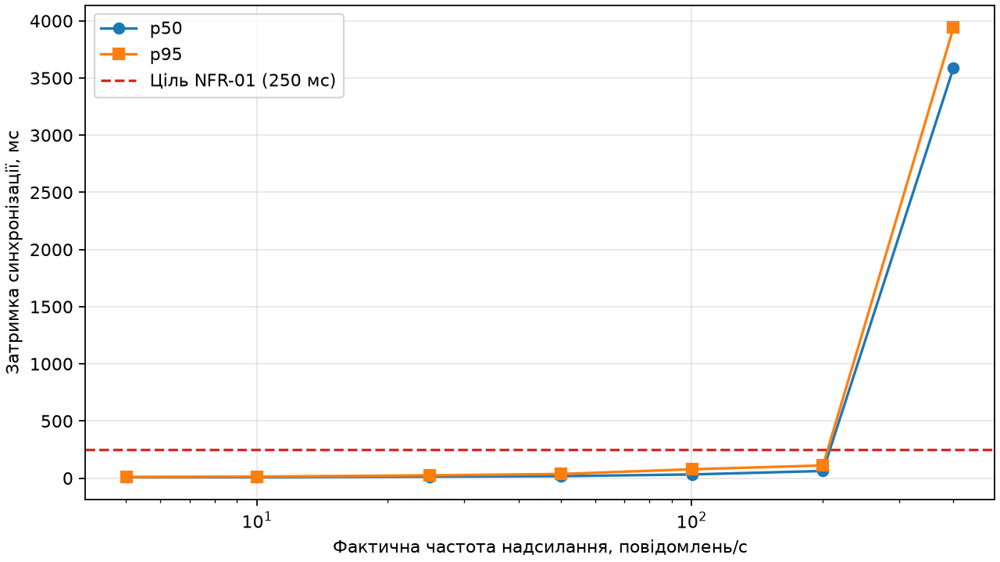

## Перевірка узгодженості

Скрипт `sync/consistency.py` порівнює відліки з `results/source.csv` з історією `twin_state` у InfluxDB за парою `seq` і `ts`. Для кожного знайденого відліку він звіряє всі 11 полів телеметрії, перевіряє порядок за ревізіями Ditto й рахує пропуски між отриманими ревізіями. Поточний стан двійника порівнюється з останнім відліком, включно з `seq` і `ts`. Затримку p50 і p95 обчислено за полем `sync_ms` лише для отриманих відліків. Ціль для p95 становить 250 мс.

### Штатний запуск

Запуск на 300 повідомлень із частотою 10 Гц за штатного відображення телеметрії.

| Перевірка | Результат |
| --- | --- |
| Надіслано джерелом | 300 |
| Є в історії двійника | 300 (100.0%) |
| Втрачено | 0 (перші номери: []) |
| Розбіжності значень | 0 (перші номери: []) |
| Позачергові оновлення | 0 |
| Пропущені ревізії між отриманими | 0 |
| Кінцевий стан збігається з останнім відліком | так |
| Затримка синхронізації p50 / p95, мс | 12.14 / 16.51 (ціль p95 ≤ 250 мс, виконано) |

### Запуск із помилкою відображення

У відображенні MQTT поміняно місцями джерела значень струму `i` та напруги `v`. Напруга близько 12 В потрапляє в поле `drive.current`, для якого модель задає максимум 5 А. Очікується, що Ditto відхилить оновлення цілком і в історії не буде відліків цього запуску.

| Перевірка | Результат |
| --- | --- |
| Надіслано джерелом | 300 |
| Є в історії двійника | 0 (0.0%) |
| Втрачено | 300 (перші номери: [1, 2, 3, 4, 5, 6, 7, 8, 9, 10]) |
| Розбіжності значень | 0 (перші номери: []) |
| Позачергові оновлення | 0 |
| Пропущені ревізії між отриманими | немає даних |
| Кінцевий стан збігається з останнім відліком | ні |
| Затримка синхронізації p50 / p95, мс | немає даних |

## Навантажувальне тестування

Locust надсилав телеметрію одному двійнику `org.pzks:mannequin-01` сімома ступенями по 60 с. Фактичну частоту обчислено за `results/sent.csv`. Відліки зіставлено з історією InfluxDB за парою `seq` і `ts`. Затримку синхронізації p50 і p95 обчислено за `sync_ms` лише для зіставлених відліків. Цільову частоту вважали досягнутою, якщо фактична становила щонайменше 95 % від неї.

| Ціль, повід./с | Факт, повід./с | Надіслано | В історії | Втрати, % | p50, мс | p95, мс | Цільову частоту досягнуто |
| ---: | ---: | ---: | ---: | ---: | ---: | ---: | :--- |
| 5 | 5,02 | 302 | 302 | 0,0 | 7,94 | 10,4 | так |
| 10 | 10,02 | 605 | 605 | 0,0 | 8,28 | 13,7 | так |
| 25 | 25,01 | 1486 | 1486 | 0,0 | 13,33 | 24,4 | так |
| 50 | 50,0 | 3019 | 3019 | 0,0 | 17,44 | 36,43 | так |
| 100 | 100,3 | 6039 | 6039 | 0,0 | 32,32 | 77,76 | так |
| 200 | 200,57 | 11880 | 11880 | 0,0 | 62,7 | 111,15 | так |
| 400 | 400,39 | 24240 | 18188 | 24,967 | 3588,34 | 3940,48 | так |

На ступені 400 повід./с в історії знайдено 18 188 із 24 240 відліків. Відповідника не мали 6052 відліки (24,967 %). Між першою та останньою зіставленими ревізіями Ditto пропусків не виявлено. Порівняння журналу з історією фіксує розбіжність у повноті, але не дає змоги встановити, на якому етапі зникли ці відліки. Зведення Locust зафіксувало 47 491 завершену MQTT-публікацію без помилок, тоді як розрахунок повноти охоплює всі 47 571 записи в журналі надсилання.

## Висновок щодо масштабованості

Поріг NFR-01 (p95 ≤ 250 мс) виконано на всіх перевірених ступенях до 200 повід./с включно. На ступені 200 повід./с фактична частота становила 200,57 повід./с, p95 — 111,15 мс, а в історії знайдено всі 11 880 відліків. На ступені 400 повід./с фактична частота зросла до 400,39 повід./с, а p95 досяг 3940,48 мс. Різкий перелом спостерігається між ступенями 200 і 400 повід./с. Точну межу між ними цей прогін не визначає. Кожен ступінь тривав 60 с, тоді як у ЛР 1 для повної перевірки NFR-01 передбачено 30 хв.

За формулою (5) середній час перебування повідомлення в системі W = 1/(μ − λ) зростає, коли інтенсивність надходження λ наближається до інтенсивності обслуговування μ. Різке зростання затримки узгоджується з накопиченням черги. Для одного двійника швидкість обробки обмежує послідовне застосування оновлень його стану.

Для більшої кількості об’єктів двійники з різними ідентифікаторами можна розподіляти між вузлами кластера Ditto. Для вищої частоти від одного об’єкта можна зменшувати витрати на обробку кожного оновлення або агрегувати відліки на шлюзі, зберігаючи детальну телеметрію окремо від поточного стану двійника.
