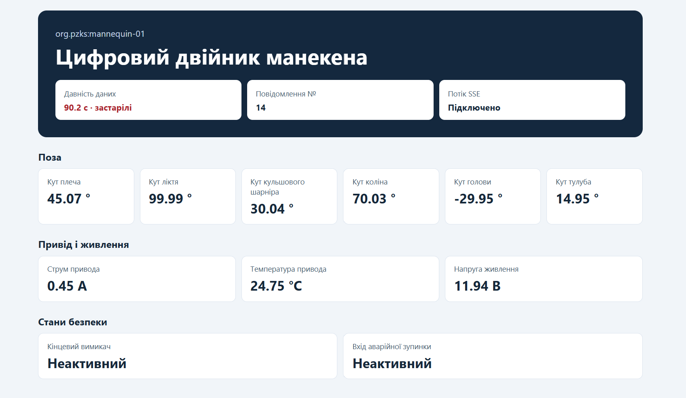

# Телеметрія роботизованого манекена

## Схема повідомлення

Емулятор публікує JSON у тему `pzks/<ім’я двійника>/telemetry` з QoS 1. Типова тема — `pzks/mannequin-01/telemetry`. Один пакет містить знімок усіх 11 сигналів. Після підтвердження публікації брокером ті самі поля записуються в `results/source.csv`. Новий запуск починає нумерацію з 1 і перезаписує CSV.

| Поле | Сигнал або призначення | Одиниця | Тип JSON | Діапазон | Роздільність подання |
|---|---|---|---|---|---|
| `seq` | Номер повідомлення в межах запуску | — | integer | ≥ 1 | 1 |
| `ts` | Час формування знімка на джерелі, Unix UTC | мс | integer | ≥ 0 | 1 мс |
| `sh` | S-01, кут плеча | ° | number | −90…90 | 0,0001° |
| `el` | S-02, кут ліктя | ° | number | 0…135 | 0,0001° |
| `hip` | S-03, кут кульшового шарніра | ° | number | −60…90 | 0,0001° |
| `kn` | S-04, кут коліна | ° | number | 0…135 | 0,0001° |
| `hd` | S-05, кут голови | ° | number | −60…60 | 0,0001° |
| `tor` | S-06, кут тулуба | ° | number | −45…45 | 0,0001° |
| `i` | S-07, СКЗ струму привода D-01 | А | number | 0…5 | 0,0001 А |
| `t` | S-08, температура привода D-01 | °C | number | −10…100 | 0,0001 °C |
| `v` | S-09, середня напруга живлення | В | number | 0…15 | 0,0001 В |
| `lim` | S-10, стан кінцевого вимикача | — | boolean | `false` або `true` | 2 стани |
| `est` | S-11, стан входу аварійного зупинення | — | boolean | `false` або `true` | 2 стани |

Роздільність у таблиці описує округлення значень емулятора. Похибку фізичного датчика не визначено. Орієнтиром для опису формату та характеристик сигналів є [IEEE 2888.1-2023](https://standards.ieee.org/ieee/2888.1/7676/). Імена полів і тема MQTT є контрактом цього стенда.

`--rate` задає частоту планових знімків. Для демонстрації використовується 1 повідомлення/с, а для передавання всіх кутових відліків у штатному режимі — 10 повідомлень/с. Температура оновлюється раз на секунду. Струм і напруга оновлюються за завершеним секундним вікном. До завершення першого вікна знімок містить початковий відлік. Коли змінюється один із дискретних входів, емулятор відразу формує знімок або включає зміну в плановий знімок цього такту. `--count` враховує всі опубліковані знімки.

## Вебподання поточного стану

1. Початковий стан сторінка зчитує через HTTP API. Подальші зміни надходять через SSE. Сторінка зберігає останні відомі значення в пам’яті й залишає їх на екрані після зупинки емулятора.
2. Давність даних обчислюється за міткою часу джерела `sync.properties.ts`. Зелений колір відповідає давності менше 2 с, жовтий — від 2 до 10 с, червоний — від 10 с.
3. Сторінка оновлює показання й індикатор давності кожні 250 мс, незалежно від частоти надходження телеметрії.

