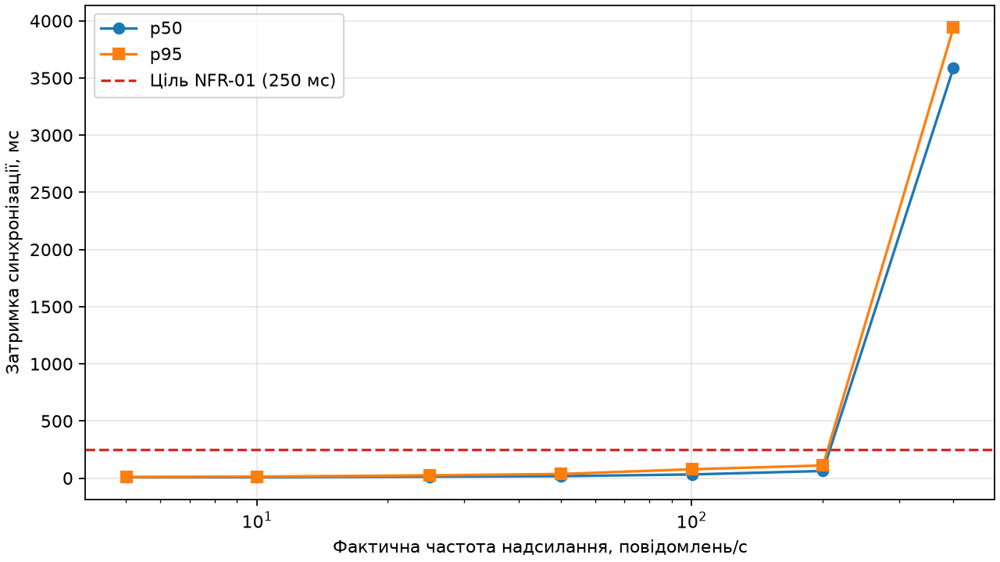

## Навантажувальне тестування

Locust генерував телеметрію для одного двійника. Частоту обчислено за журналом надсилання, а затримку — за полем `sync_ms` в історії InfluxDB. Ступінь вважається досягнутим, якщо фактична частота становить щонайменше 95% цільової.

| Ціль, повід./с | Факт, повід./с | Надіслано | В історії | Втрати, % | p50, мс | p95, мс | Цільову частоту досягнуто |
| ---: | ---: | ---: | ---: | ---: | ---: | ---: | :--- |
| 5 | 5.02 | 302 | 302 | 0.0 | 7.94 | 10.4 | так |
| 10 | 10.02 | 605 | 605 | 0.0 | 8.28 | 13.7 | так |
| 25 | 25.01 | 1486 | 1486 | 0.0 | 13.33 | 24.4 | так |
| 50 | 50.0 | 3019 | 3019 | 0.0 | 17.44 | 36.43 | так |
| 100 | 100.3 | 6039 | 6039 | 0.0 | 32.32 | 77.76 | так |
| 200 | 200.57 | 11880 | 11880 | 0.0 | 62.7 | 111.15 | так |
| 400 | 400.39 | 24240 | 18188 | 24.967 | 3588.34 | 3940.48 | так |

Без відповідника в історії залишилося 6052 відліків. Кількість пропусків між отриманими ревізіями Ditto — 0. Пропущені ревізії вказують на неповноту шляху спостереження. Цей підрахунок охоплює лише інтервал між першою й останньою зіставленими ревізіями.

## Висновок щодо масштабованості

Найвищий перевірений ступінь із p95 ≤ 250 мс — 200 повід./с (фактично 200.57 повід./с, p95 = 111.15 мс, частка відліків без відповідника в історії — 0.0%). Це результат для отриманих відліків і тривалості цього прогону.

За моделлю черги (5) середній час перебування повідомлення в системі W = 1/(μ − λ) зростає, коли інтенсивність надходження λ наближається до інтенсивності обслуговування μ. Для одного двійника послідовне застосування оновлень обмежує його пропускну здатність.

Для більшої кількості об’єктів різні двійники можна розподілити між вузлами кластера Ditto. Для вищої частоти одного об’єкта варто скорочувати вартість обробки окремого оновлення або агрегувати часті відліки на шлюзі, зберігаючи детальну телеметрію окремо від поточного стану двійника.
